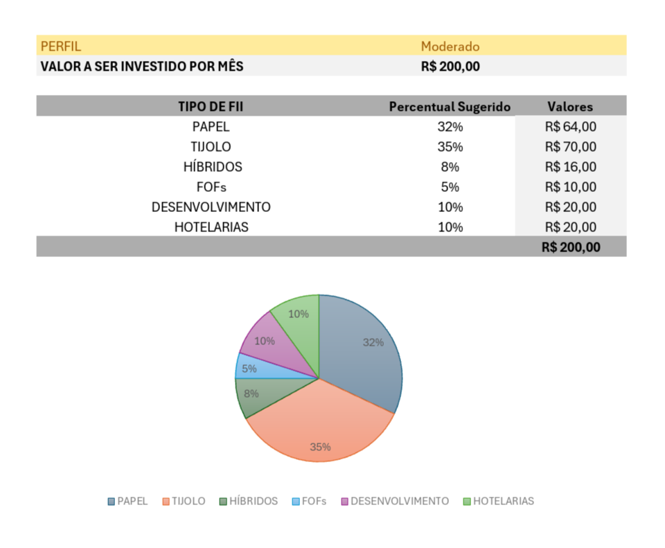
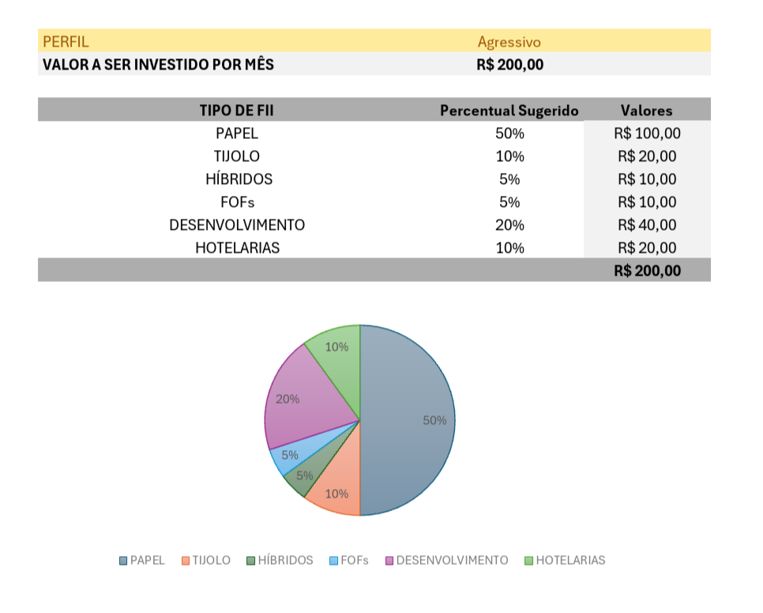

# 📊 Ferramenta de Controle de Investimentos com Excel

Este projeto consiste em uma **planilha interativa no Excel** que simula investimentos em **fundos imobiliários (FIIs)**, permitindo calcular aportes mensais, projeções de patrimônio e dividendos ao longo do tempo.  

O objetivo é criar uma ferramenta com **cara de aplicativo**, que qualquer pessoa possa usar sem precisar conhecer fórmulas do Excel.

---

## 🎯 Perguntas de Negócio Respondidas
A ferramenta foi construída para responder às seguintes questões:
1. Quanto investir por mês;
2. Por quantos anos investir;
3. Qual a taxa de rendimento mensal;
4. Quanto de patrimônio será acumulado;
5. Quanto será recebido de dividendos por mês.

---

## ⚙️ Funcionalidades
- Projeção de patrimônio acumulado em diferentes cenários (2, 5, 10, 20 e 30 anos);
- Cálculo automático de dividendos mensais;
- Configuração de salário e sugestão de aporte (30% do salário);
- Divisão do aporte entre **seis tipos de fundos imobiliários**, conforme o perfil de investidor escolhido;
- Interface visual limpa e intuitiva (linhas de grade ocultas, células calculadas destacadas em cinza);
- Possibilidade de simular diferentes perfis de investidor.

---

## 🧮 Fórmulas Utilizadas
- **VF (Valor Futuro):** utilizada para calcular o patrimônio acumulado ao longo do tempo.  
  - `=VF(taxa_mensal; número_de_períodos; -aporte; 0)`  
  - Onde:
    - `taxa_mensal`: rendimento mensal da carteira;
    - `número_de_períodos`: total de meses (anos × 12);
    - `aporte`: valor investido mensalmente.

- **PROCV (Procura Vertical):** usada para trazer os percentuais de cada tipo de fundo conforme o perfil selecionado.  
  - A chave composta garante que o PROCV encontre corretamente o percentual de cada fundo para cada perfil.

---

## 🔖 Intervalos Nomeados
Para facilitar a manutenção e leitura das fórmulas, foram criados intervalos nomeados:
- `aporte`
- `taxa_mensal`
- `salario`
- `perfil`

---

## 📈 Perfis de Investidor

Os percentuais de cada perfil foram definidos na aba de apoio da planilha:

- **Conservador**  
  - Papel: 30%  
  - Tijolo: 50%  
  - Híbridos: 10%  
  - FOFs: 10%  
  - Desenvolvimento: 0%  
  - Hotelarias: 0%  

- **Moderado**  
  - Papel: 32%  
  - Tijolo: 35%  
  - Híbridos: 8%  
  - FOFs: 5%  
  - Desenvolvimento: 10%  
  - Hotelarias: 10%  

- **Agressivo**  
  - Papel: 50%  
  - Tijolo: 10%  
  - Híbridos: 5%  
  - FOFs: 5%  
  - Desenvolvimento: 20%  
  - Hotelarias: 10%  

*(Esses percentuais são apenas ilustrativos, não constituem recomendação de investimento.)*

---

## 🖼️ Evidências

### Simulação Perfil Moderado

### Simulação Perfil Agressivo

---

## 📥 Download da Planilha
👉 [Clique aqui para baixar a planilha](planilha/investimento.xlsx)

A simulação exibida nos prints corresponde exatamente ao arquivo Excel publicado neste repositório.

---

## 🚀 Ideias para Evolução
- Gráfico de pizza dinâmico mostrando a divisão do aporte por perfil;
- Simulação automática com 30% do salário como aporte;
- Novas projeções de patrimônio (ex.: 15 anos, 25 anos);
- Ocultar barra de fórmulas e guias para versão final;
- Criar ferramentas semelhantes (ex.: planejamento de férias).
